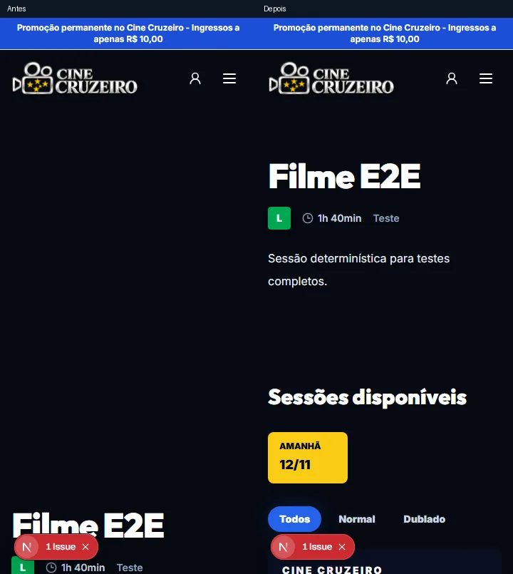

# Validação visual do Cine Cruzeiro

O Chromium abriu as rotas com a instalação sintética do Playwright. A matriz registra a largura solicitada, a maior diferença entre a largura do documento e a viewport e a rota efetivamente aberta. O acesso direto ao checkout sem login exercita a tela de identificação. As jornadas de compra autenticadas foram exercitadas nos testes de checkout.

| Tela ou aba | Larguras testadas (px) | Excesso horizontal máximo | Caminho final |
| --- | --- | ---: | --- |
| / | 360, 390, 768, 1366, 1920 | 0 px | / |
| /filmes | 360, 390, 768, 1366, 1920 | 0 px | /filmes |
| /filmes/filme-e2e | 360, 390, 768, 1366, 1920 | 0 px | /filmes/filme-e2e |
| /eventos | 360, 390, 768, 1366, 1920 | 0 px | /eventos |
| /o-cinema | 360, 390, 768, 1366, 1920 | 0 px | / |
| /privacidade | 360, 390, 768, 1366, 1920 | 0 px | /privacidade |
| /termos | 360, 390, 768, 1366, 1920 | 0 px | /termos |
| /conta | 360, 390, 768, 1366, 1920 | 0 px | /conta |
| /conta/ingressos | 360, 390, 768, 1366, 1920 | 0 px | /conta/ingressos |
| /clube | 360, 390, 768, 1366, 1920 | 0 px | /clube |
| /clube/assinar/plano-e2e | 360, 390, 768, 1366, 1920 | 0 px | /clube/assinar/plano-e2e |
| /checkout/sessao-poltronas-e2e | 360, 390, 768, 1366, 1920 | 0 px | /checkout/sessao-poltronas-e2e |
| /checkout/sessao-e2e/extras | 360, 390, 768, 1366, 1920 | 0 px | /checkout/sessao-e2e/extras |
| /checkout/sessao-e2e/pagamento | 360, 390, 768, 1366, 1920 | 0 px | /checkout/sessao-e2e/pagamento |
| /checkout/sessao-e2e/confirmacao | 360, 390, 768, 1366, 1920 | 0 px | /checkout/sessao-e2e/confirmacao |
| /social-editor | 360, 390, 768, 1366, 1920 | 0 px | /social-editor |
| /inexistente | 360, 390, 768, 1366, 1920 | 0 px | /inexistente |
| login-admin | 360, 390, 768, 1366, 1920 | 0 px | /admin/ |
| dashboardPanel | 360, 390, 768, 1366, 1920 | 0 px | /admin/ |
| moviesPanel | 360, 390, 768, 1366, 1920 | 0 px | /admin/ |
| roomsPanel | 360, 390, 768, 1366, 1920 | 0 px | /admin/ |
| roomsPanel-Salas cadastradas | 360, 390, 768, 1366, 1920 | 0 px | /admin/ |
| roomsPanel-Agenda de sessões | 360, 390, 768, 1366, 1920 | 0 px | /admin/ |
| roomsPanel-Em andamento | 360, 390, 768, 1366, 1920 | 0 px | /admin/ |
| ticketsPanel | 360, 390, 768, 1366, 1920 | 0 px | /admin/ |
| ordersPanel | 360, 390, 768, 1366, 1920 | 0 px | /admin/ |
| ordersPanel-Nova venda | 360, 390, 768, 1366, 1920 | 0 px | /admin/ |
| ordersPanel-Vendas de hoje | 360, 390, 768, 1366, 1920 | 0 px | /admin/ |
| ordersPanel-Pedidos | 360, 390, 768, 1366, 1920 | 0 px | /admin/ |
| ordersPanel-Financeiro / Pagamentos | 360, 390, 768, 1366, 1920 | 0 px | /admin/ |
| ordersPanel-Validar ingresso | 360, 390, 768, 1366, 1920 | 0 px | /admin/ |
| concessionsPanel | 360, 390, 768, 1366, 1920 | 0 px | /admin/ |
| concessionsPanel-Vendas de hoje | 360, 390, 768, 1366, 1920 | 0 px | /admin/ |
| concessionsPanel-Venda presencial | 360, 390, 768, 1366, 1920 | 0 px | /admin/ |
| concessionsPanel-Cardápio / Categorias | 360, 390, 768, 1366, 1920 | 0 px | /admin/ |
| concessionsPanel-Financeiro | 360, 390, 768, 1366, 1920 | 0 px | /admin/ |
| concessionsPanel-Validar retirada (QR Code) | 360, 390, 768, 1366, 1920 | 0 px | /admin/ |
| marketingPanel | 360, 390, 768, 1366, 1920 | 0 px | /admin/ |
| marketingPanel-Visão geral | 360, 390, 768, 1366, 1920 | 0 px | /admin/ |
| marketingPanel-Home | 360, 390, 768, 1366, 1920 | 0 px | /admin/ |
| marketingPanel-Social Studio | 360, 390, 768, 1366, 1920 | 0 px | /admin/ |
| marketingPanel-Campanhas | 360, 390, 768, 1366, 1920 | 0 px | /admin/ |
| marketingPanel-Cupons | 360, 390, 768, 1366, 1920 | 0 px | /admin/ |
| marketingPanel-Anúncios | 360, 390, 768, 1366, 1920 | 0 px | /admin/ |
| clubPanel | 360, 390, 768, 1366, 1920 | 0 px | /admin/ |
| clubPanel-Visão geral | 360, 390, 768, 1366, 1920 | 0 px | /admin/ |
| clubPanel-Aparência | 360, 390, 768, 1366, 1920 | 0 px | /admin/ |
| clubPanel-Planos | 360, 390, 768, 1366, 1920 | 0 px | /admin/ |
| clubPanel-Assinaturas | 360, 390, 768, 1366, 1920 | 0 px | /admin/ |
| clubPanel-Créditos | 360, 390, 768, 1366, 1920 | 0 px | /admin/ |
| usersPanel | 360, 390, 768, 1366, 1920 | 0 px | /admin/ |
| usersPanel-Equipe e permissões | 360, 390, 768, 1366, 1920 | 0 px | /admin/ |
| usersPanel-Clientes | 360, 390, 768, 1366, 1920 | 0 px | /admin/ |
| usersPanel-Minha segurança | 360, 390, 768, 1366, 1920 | 0 px | /admin/ |
| integrationsPanel | 360, 390, 768, 1366, 1920 | 0 px | /admin/ |
| logsPanel | 360, 390, 768, 1366, 1920 | 0 px | /admin/ |

O filme sem pôster reservava uma caixa de 300 × 450 px no detalhe. A caixa agora ocupa zero espaço quando a arte está ausente. O título e a data da sessão cabem na primeira tela de 360 × 780 px. No catálogo, o título também abre o detalhe por teclado. A imagem abaixo usa dados sintéticos.

Nos demais estados da matriz, a largura do documento ficou dentro da viewport. A medição admite rolagem interna de tabelas e da faixa de datas. O percurso verificou abertura das abas. Salvar todos os formulários, abrir o teclado virtual de um aparelho físico, operar o leitor de tela, imprimir no balcão e usar a câmera física ficam fora dessa evidência. A captura do editor social sem uma cena exercita seu estado de entrada. A matriz contém o login e as telas permitidas ao administrador sintético.
